# Desktop client — redesign

Mockups for the next look of the desktop app (`clients/desktop`, iced 0.14). They are built on the
**home-space design system** (the web client's tokens), so web and desktop read as one product, and
start from the current UI.

- `screens/` — PNG of every screen, light and dark (`<Screen>-light.png`, `<Screen>-dark.png`), 2x.
- `html/` — the same screens as standalone pages. Open them in a browser; add `dark` to the `.hs`
  element's class to switch theme.
- `iced/tokens.rs` — reference `Tokens` for light and dark, the radii, and the iced `Theme`. Not compiled.
- `source/` — the editable design canvas (`*.dc.html`, `canvas.json`, `hs.css`).
- `tools/` — regenerates `html/` and `screens/` from `source/`.

The live, editable canvas is the Claude design artifact “Home Space Desktop — redesign”. When it
changes, export its `project/` files into `source/` and run the tools (see Updating).

## Naming

The product is **Home Space** in every UI string. `home-space` is only the repo and code name.

## Foundations

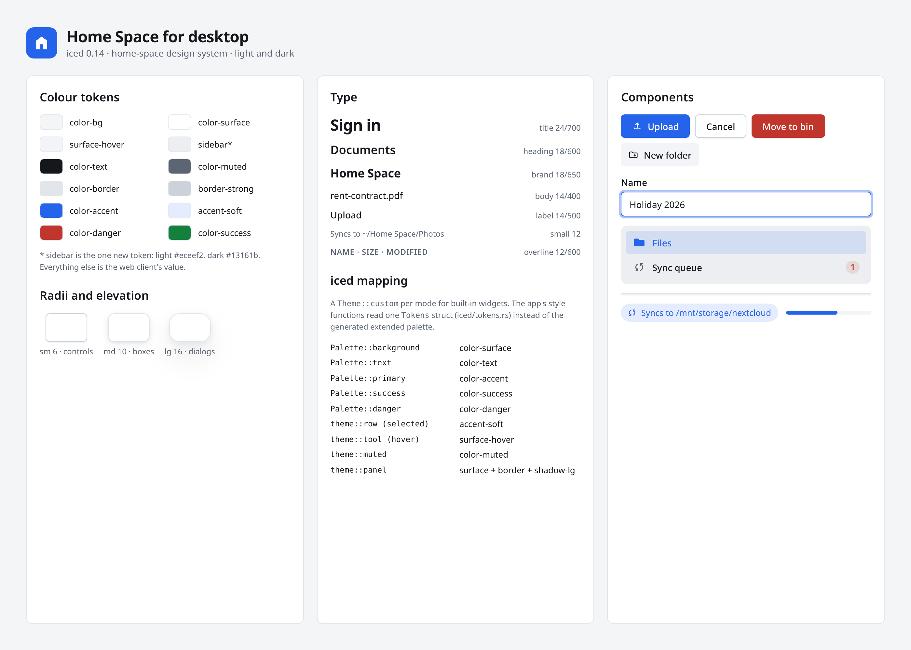

### Colour

The web client's values, one-to-one. The only new token is `sidebar`.

| Token | Light | Dark | Used for |
|---|---|---|---|
| bg | `#F4F5F7` | `#0E1014` | Window background |
| surface | `#FFFFFF` | `#171A20` | Listing box, panels, dialogs, inputs, buttons |
| surface-hover | `#F2F4F7` | `#1E222A` | Hover, sticky table header, progress tracks |
| sidebar | `#ECEEF2` | `#13161B` | Sidebar background (new) |
| text | `#14171C` | `#E7E9EC` | Text |
| muted | `#5C6573` | `#98A1B0` | Secondary text, column headers, icons |
| border | `#E2E5EA` | `#262B34` | Hairlines, row dividers, panel outlines |
| border-strong | `#CDD2DA` | `#353B46` | Control outlines |
| accent | `#2563EB` | `#6D9EFF` | Primary buttons, folders, checked boxes, progress, focus |
| accent-soft | accent at 12% | accent at 12% | Selected rows, active sidebar item, drop overlay |
| danger | `#C0362C` | `#FF8A80` | Delete, errors |
| success | `#15803D` | `#5FD39A` | Up to date, Done |

### Type, shape, icons

- Type: the system UI font (Noto Sans on KDE). 14px body and labels, 18px/600 headings and
  breadcrumbs, 12px/600 uppercase column headers, 24px/700 only on the sign-in card. Tabular numerals
  for sizes and dates.
- Radii: 6px for controls and menu items, 10px for the listing box, details panel and menus, 16px
  for dialogs and floating panels.
- Elevation: a faint shadow on resting boxes, a large one on dialogs, menus and the transfer panel.
- Icons: Material Symbols Outlined at 20px, the same set already in `clients/desktop/assets/icons`.
  New ones the mockups use: `home`, `search`, `key`, `dns`, `visibility`, `cloud_off`, `laptop`,
  `smartphone`, `tablet`, `language`, `expand_more`, `chevron_right`, `verified`, `error`.

### iced mapping

`iced/tokens.rs` gives a `Theme::custom` per mode, so built-in widgets (text inputs, scrollables,
checkboxes) get the right colours, and a `Tokens` struct for the app's own style functions in
`theme.rs`:

| Style function today | Token |
|---|---|
| `theme::row` (selected / hover) | accent-soft / surface-hover |
| `theme::header` | surface-hover, muted text |
| `theme::tool` (hover / pressed) | surface-hover |
| `theme::panel` | surface, border, radius-lg, large shadow |
| `theme::backdrop` | backdrop (`#080A0E` at 55%) |
| `theme::muted` | muted |
| `theme::error`, `theme::danger_tool` | danger |

## Screens

| Screen | Image | Code today |
|---|---|---|
| Sign in | `Login` | `login.rs` |
| Resuming failed | `Resuming` | `login.rs` |
| Files | `Browser` | `browser/layout.rs`, `toolbar.rs`, `grid.rs` |
| Selection and context menu | `Selection` | `browser/selection.rs`, `context_menu.rs` |
| Details | `Details` | `browser/details.rs` |
| Drop to upload, transfers | `Upload` | `browser/layout.rs`, `transfers.rs` |
| New folder | `NewFolder` | `browser/dialogs.rs` |
| Move | `Move` | `browser/dialogs.rs` |
| Move to bin | `Delete` | `browser/dialogs.rs` |
| Sync a folder locally | `SyncFolder` | `browser/syncing.rs` |
| Search results | `Search` | `browser/search.rs` |
| Sync queue | `SyncQueue` | `browser/sync_queue.rs` |
| Recycle bin | `Trash` | `browser/trash.rs` |
| Devices | `Devices` | `browser/devices.rs` |
| Sync settings | `SyncSettings` | `browser/syncing.rs` (settings modal) |

### Sign in

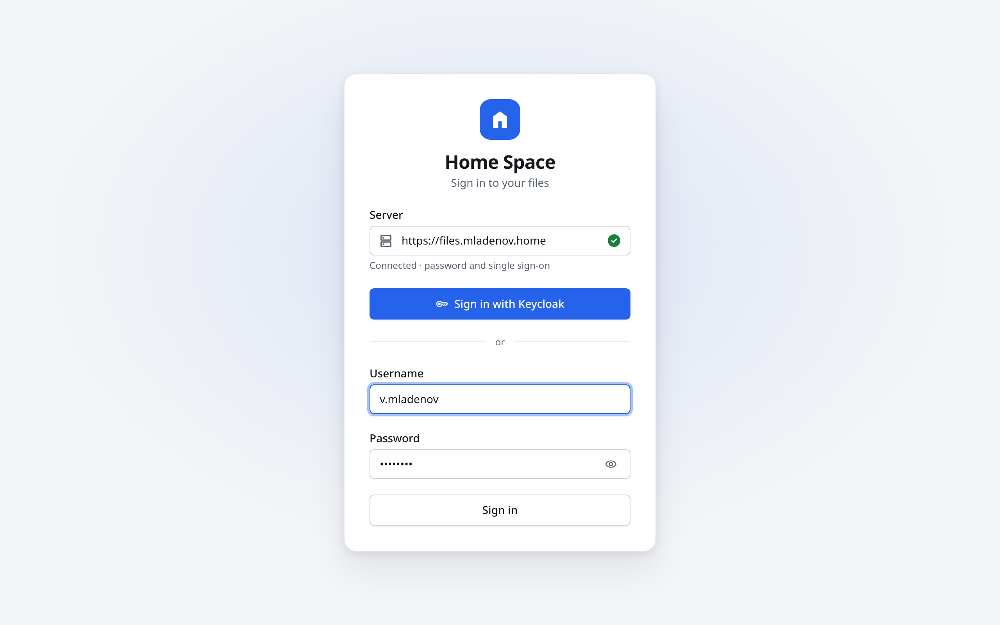 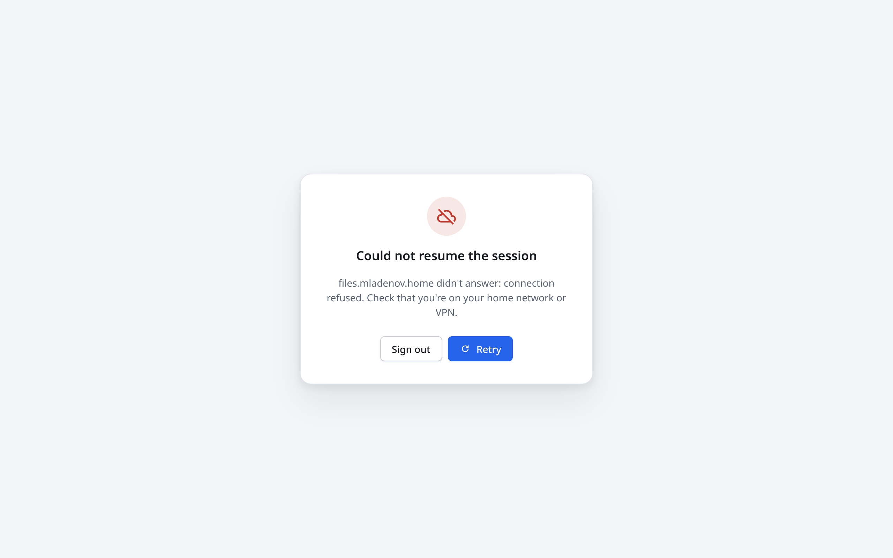

- A centred card on `bg` with the soft accent glow, as in the web client.
- The server field shows its state inline (checking, connected, error).
- Single sign-on is the primary button; the password form sits below an “or” divider.
- Resuming failed: an icon, the reason, Sign out and a primary Retry.

### Files

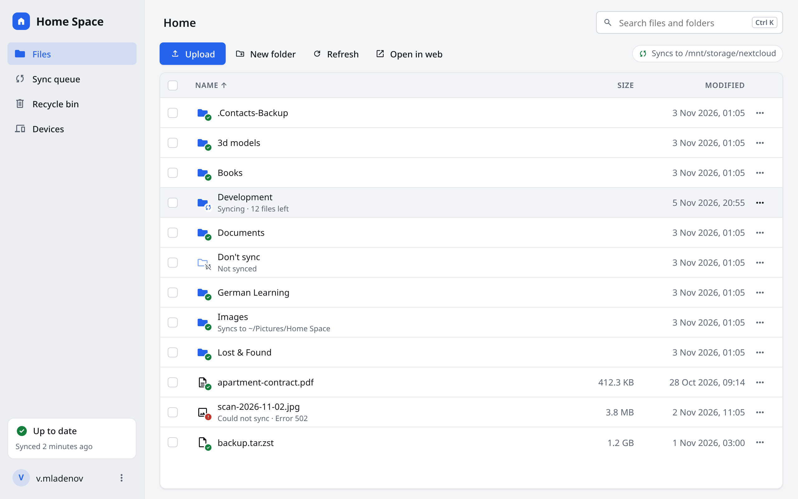 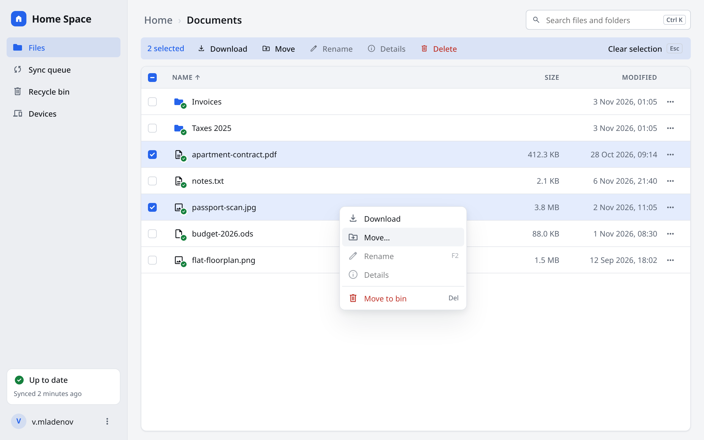

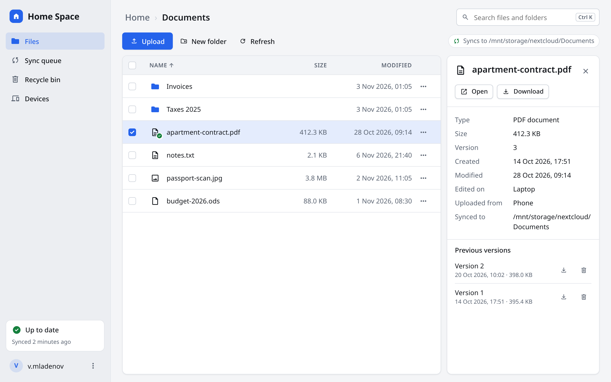 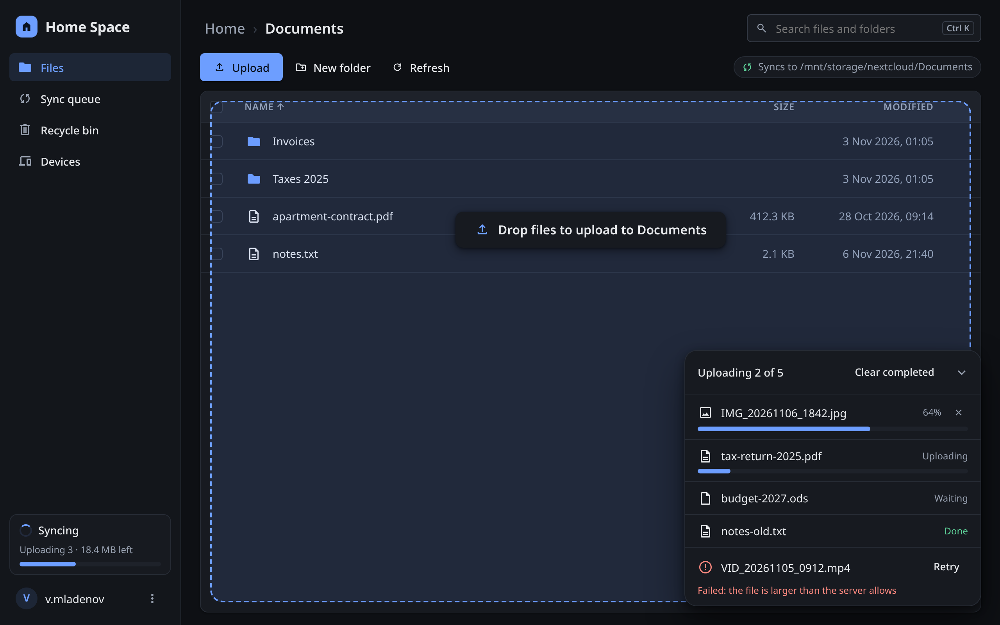

- **Sidebar** for the places: Files, Sync queue, Recycle bin, Devices. Today they are toolbar buttons
  on the right. The Sync queue item shows a count when something failed.
- The **sync status** moves to the sidebar footer and opens Sync settings. The **account** sits under
  it; Sign out is in its menu.
- **Header**: breadcrumbs as the title, search on the right.
- **Toolbar**: Upload is the only primary button; New folder, Refresh and Open in web are ghost buttons.
- **Sync path**: the local path is no longer repeated under every row. A chip above the list says
  where the folder syncs; a row only gets a second line when it differs (its own location, “Not
  synced”, an error, syncing progress).
- **Listing**: one bordered box with the sticky uppercase header; files show their size.
- **Selection**: the toolbar turns into a tinted bar with the count, the actions and Clear selection
  (Esc). The context menu has the same actions with their shortcuts; Move to bin is last, in danger.
- **Details**: a 320px side panel with Open / Download, the facts, and previous versions.
- **Upload**: dropping files shows the dashed accent overlay; transfers float bottom-right with
  per-file progress, Retry and Clear completed.

### Dialogs

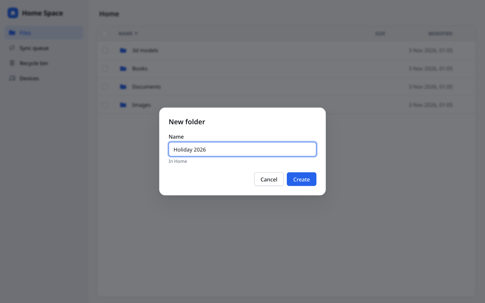 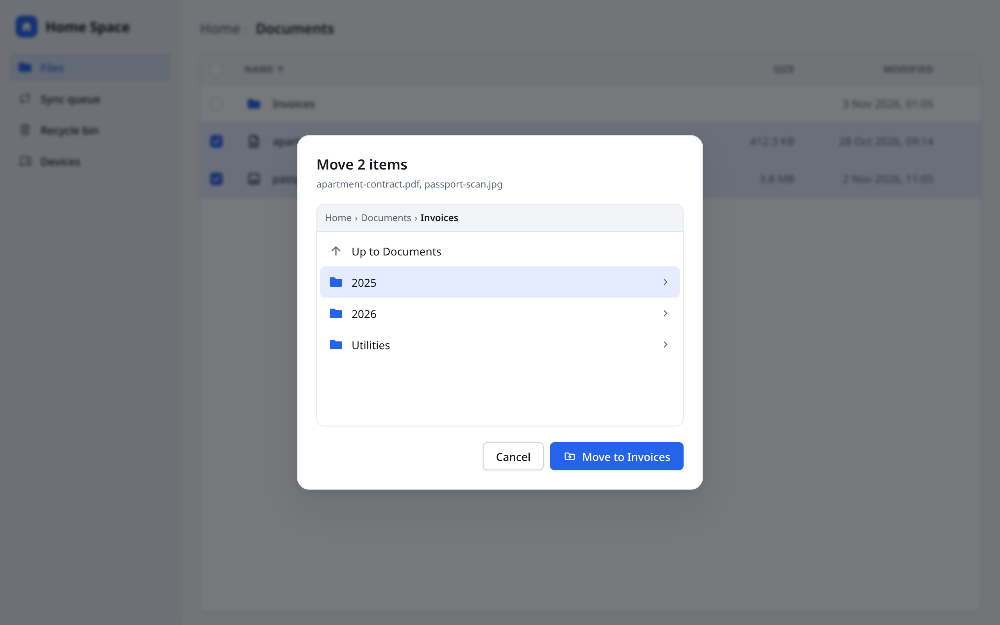

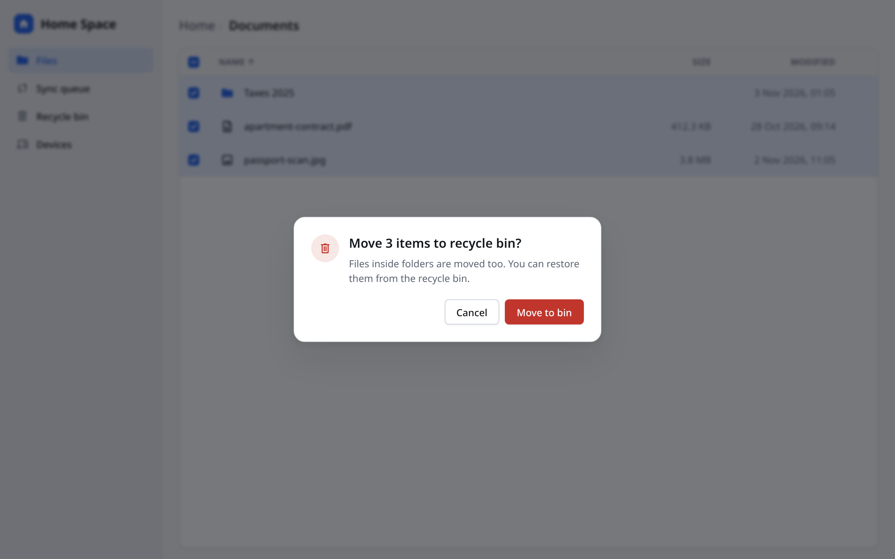 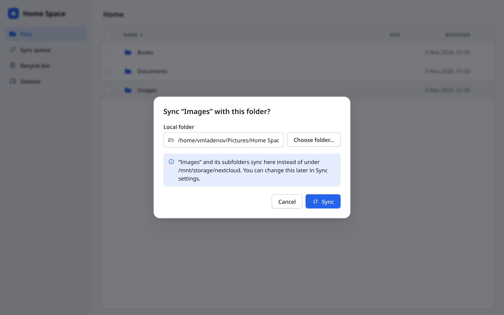

- One modal style: 16px radius, large shadow, blurred backdrop.
- Buttons on the right: a secondary (outlined) button, then the primary one. Destructive actions use
  `danger`; the move-to-bin dialog has a danger icon.
- Move shows breadcrumbs, an Up row and folder rows; the button names the destination.
- Sync a folder confirms the local folder before anything changes.

### Search, sync, recycle bin, devices

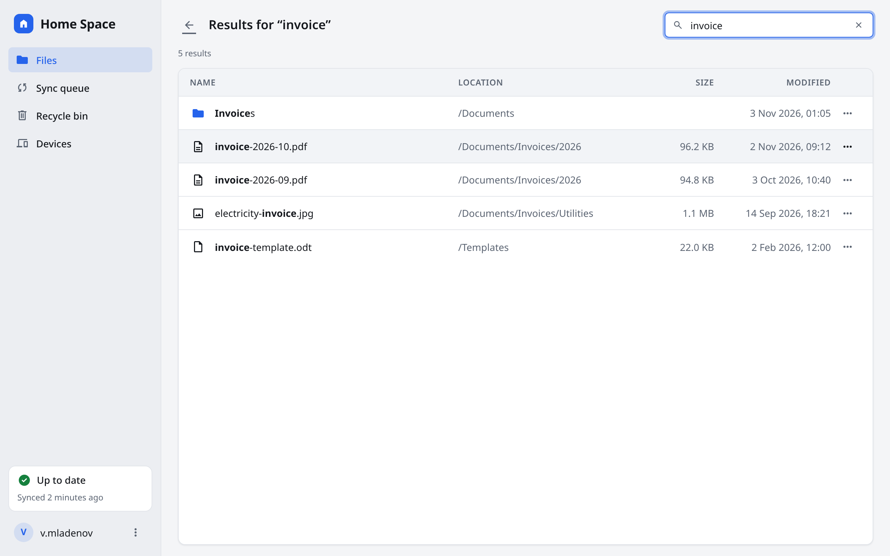 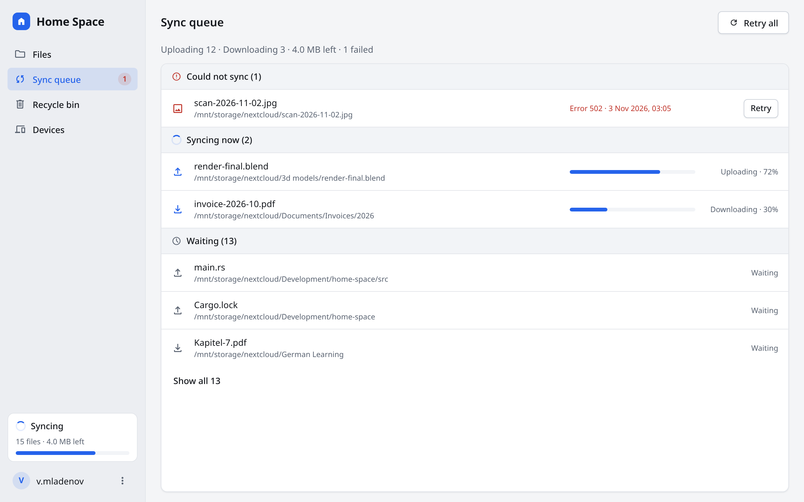

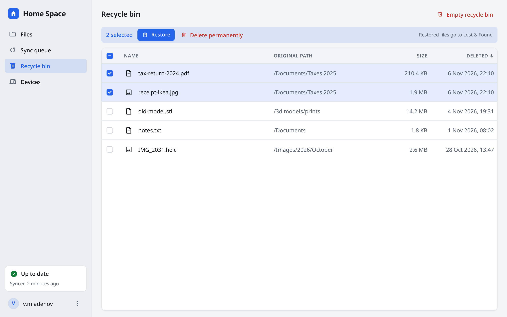 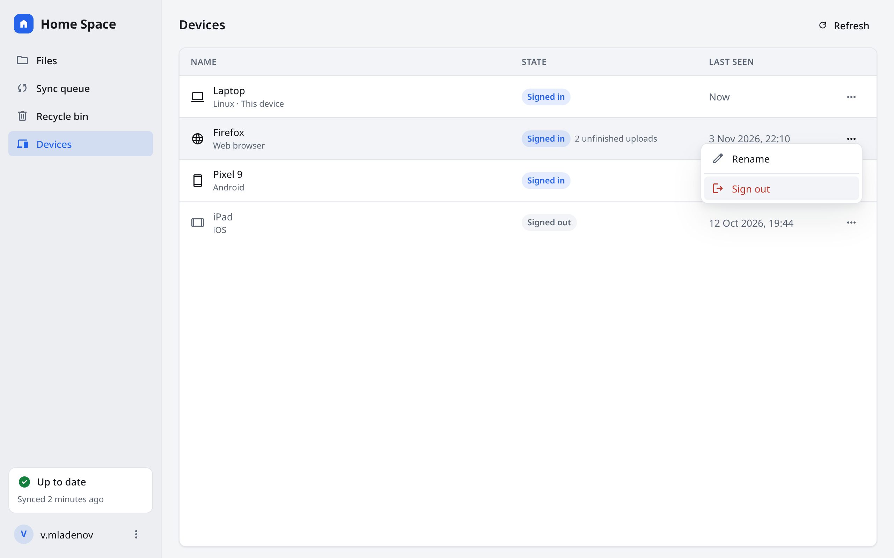

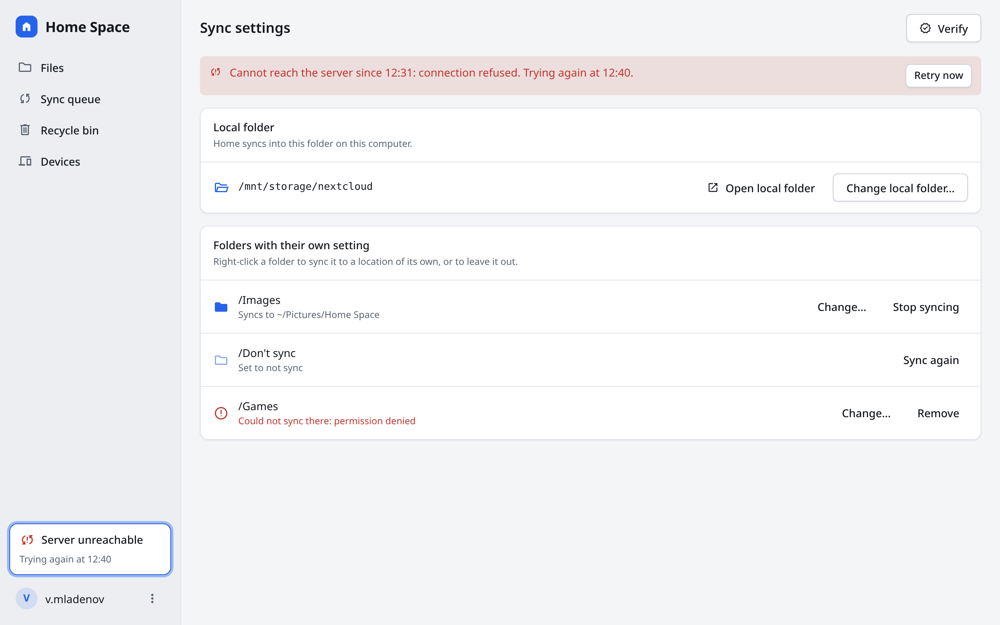

- Pages keep the sidebar; the page title replaces the breadcrumbs.
- **Search**: “Results for …” with the matched part in bold and a Location column.
- **Sync queue**: the summary line, then Could not sync / Syncing now / Waiting sections with
  per-item progress and Retry.
- **Recycle bin**: an Original path column, Restore as the primary action for a selection, Empty
  recycle bin in danger.
- **Devices**: one row per device with a state pill; Rename and Sign out in the row menu.
- **Sync settings**: a page instead of a modal — the outage notice with Retry now, the local folder,
  and the folders with their own setting.

### Not in the app yet

These are proposals; drop the ones you don't want:

- Ctrl+K to focus search.
- Show/hide on the password field.
- Delete permanently for a selection in the recycle bin.
- The per-row sync state line (“Syncing · 12 files left”, “Could not sync · Error 502”).

## Updating

1. Edit the canvas, then copy its `project/*.dc.html`, `project/hs.css` and `project/canvas.json`
   into `source/`.
2. Regenerate the pages and images:

   ```sh
   cd docs/designs/desktop/tools
   npm install
   npx playwright install chromium
   npm run build
   ```

The `.dc.html` files need the canvas runtime, so open `html/` (not `source/`) in a browser.
