# Android client — Material 3 redesign

Mockups for the next look of the Android app (`clients/mobile/androidApp`). They follow
[Material Design 3](https://m3.material.io) and start from the current Compose UI. Use them as the
target when changing the app's screens.

- `screens/` — PNG of every screen, light and dark (`<Screen>-light.png`, `<Screen>-dark.png`), 2x.
- `html/` — the same screens as standalone pages. Open them in a browser; add `dark` (or `dyn` for
  the sample wallpaper scheme) to the `.m3` element's class to switch theme.
- `compose/Theme.kt` — reference `ColorScheme`s and the `HomeSpaceTheme` composable. Not compiled.
- `source/` — the editable design canvas (`*.dc.html`, `canvas.json`, `m3.css`).
- `tools/` — regenerates `html/` and `screens/` from `source/`.

The live, editable canvas is the Claude design artifact “Home Space Android — Material 3 redesign”.
When it changes, export its `project/` files into `source/` and run the tools (see Updating).

## Naming

The product is **Home Space** in every UI string. `home-space` is only the repo and code name.

## Foundations

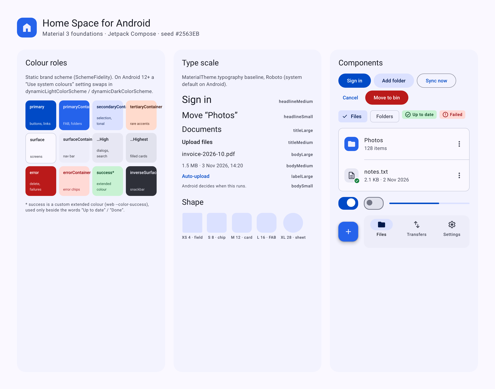

### Colour

A static brand scheme generated with `SchemeFidelity` from the web accent `#2563EB`, so
`primaryContainer` is exactly the web client's accent. On Android 12+ a “Use system colours”
setting switches to `dynamicLightColorScheme` / `dynamicDarkColorScheme`.

| Role | Light | Dark | Used for |
|---|---|---|---|
| primary | `#004AC6` | `#B4C5FF` | Filled buttons, links, progress, checked controls |
| primaryContainer | `#2563EB` | `#2563EB` | FAB, folder icon tiles, avatar |
| secondaryContainer | `#DBE1FF` | `#33467E` | Selected rows, tonal buttons, active nav item |
| tertiaryContainer | `#FFDBCD` | `#7A2C00` | Auto-upload source icons only |
| surface | `#FAF8FF` | `#11131B` | Screens |
| surfaceContainer | `#EDEDF9` | `#1D1F27` | Navigation bar, bottom toolbar |
| surfaceContainerLow | `#F3F3FE` | `#191B23` | Bottom sheets |
| surfaceContainerHigh | `#E7E7F3` | `#282A32` | Dialogs, search view, file icon tiles |
| surfaceContainerHighest | `#E1E2ED` | `#32343D` | Filled cards |
| onSurfaceVariant | `#434655` | `#C3C6D7` | Supporting text, icons |
| outlineVariant | `#C3C6D7` | `#434655` | Dividers, outlined cards |
| error / errorContainer | `#BA1A1A` / `#FFDAD6` | `#FFB4AB` / `#93000A` | Delete, failures |
| success (extended) | `#15803D` | `#5FD39A` | Only beside “Up to date” / “Done” |

The full list is in `compose/Theme.kt` and `source/m3.css`.

### Type, shape, icons

- Type: the Material 3 baseline scale with Roboto (`MaterialTheme.typography` defaults). Screen titles
  `titleLarge`, list headlines `bodyLarge`, supporting lines `bodyMedium`, section headers
  `titleSmall` in `primary`, dialog titles `headlineSmall`. Sizes and dates use tabular numerals.
- Shape: Material defaults — fields 4dp, chips 8dp, cards and icon tiles 12dp, FAB 16dp, dialogs and
  sheets 28dp.
- Icons: Material Symbols Outlined, 24dp (filled for the active nav item and folder icons).

## Screens

| Screen | Image | Replaces / affects |
|---|---|---|
| Sign in | `Login` | `LoginScreen` |
| Sign in — waiting for single sign-on | `LoginSso` | `LoginScreen` (pending SSO) |
| Resuming failed | `Resuming` | `ResumingScreen` |
| Files | `Browse` | `BrowseScreen`, `CurrentFolder`, `AccountMenu`, `UploadsSummaryRow` |
| Selection | `Selection` | `BrowseScreen` selection mode, `SelectionActions` |
| New menu | `NewMenu` | `AddButton` |
| Row actions | `FileActions` | `RowMenu` |
| Details | `Details` | `DetailsSheet` |
| Rename | `RenameDialog` | `NameDialog` (rename / new folder) |
| Move to bin | `DeleteDialog` | `DeleteDialog` |
| Move | `Move` | `MoveDialog` |
| Search | `Search` | `SearchScreen` |
| Transfers | `Transfers` | `TransfersScreen` |
| Settings | `Settings` | `AccountPageScreen` (Settings), `SyncSettingsScreen` switches |
| Folders that upload | `Sync` | `SyncSettingsScreen` sources |
| Profile | `Profile` | `AccountPageScreen` (Profile, empty today) |

### Sign in

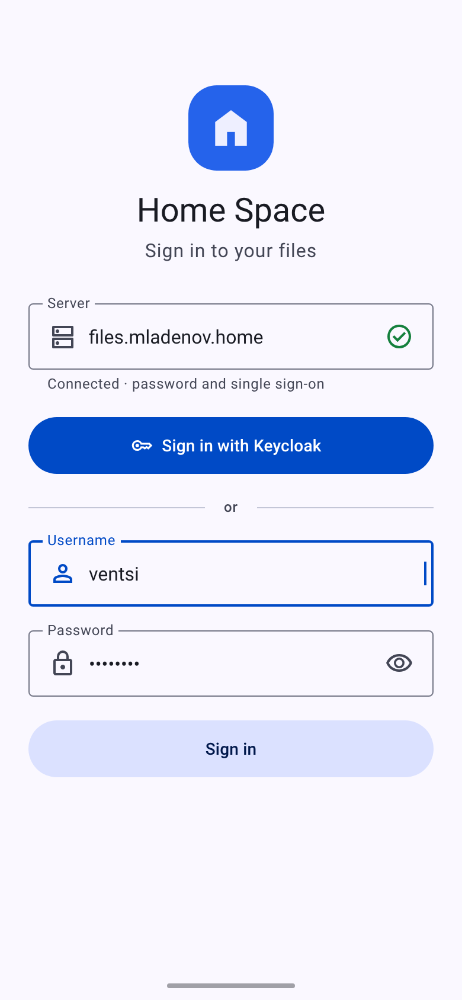 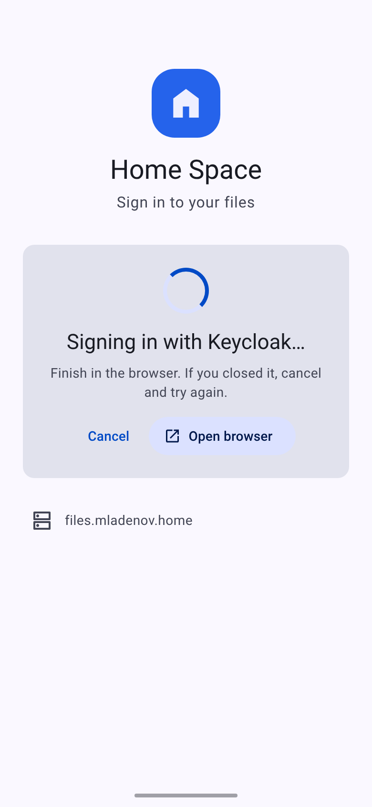 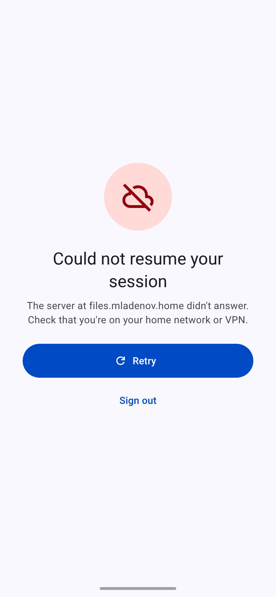

- App icon tile and “Home Space” headline above the form.
- The server field shows its state in the supporting line (checking, connected, error) and a trailing
  icon, instead of separate text rows.
- Single sign-on is the filled button; the password form sits under an “or” divider and submits with a
  tonal button. The password field has a show/hide toggle.
- Resuming failed: an error illustration tile, a filled Retry, and a text Sign out.

### Files

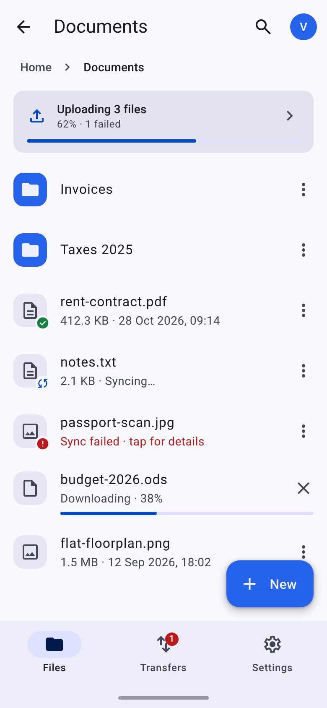 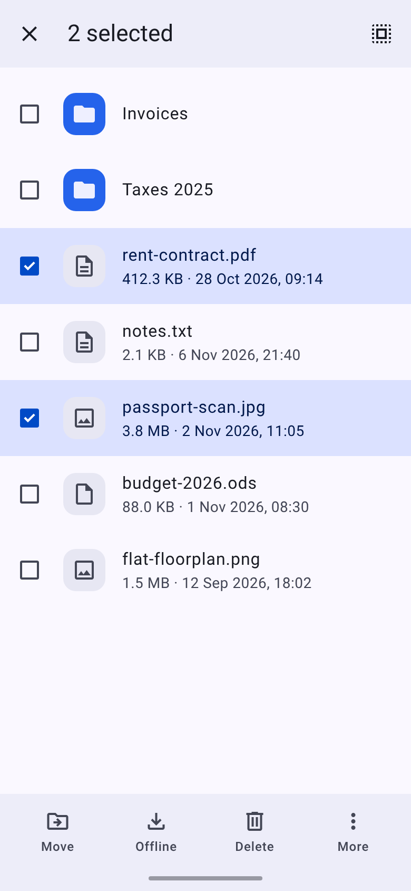 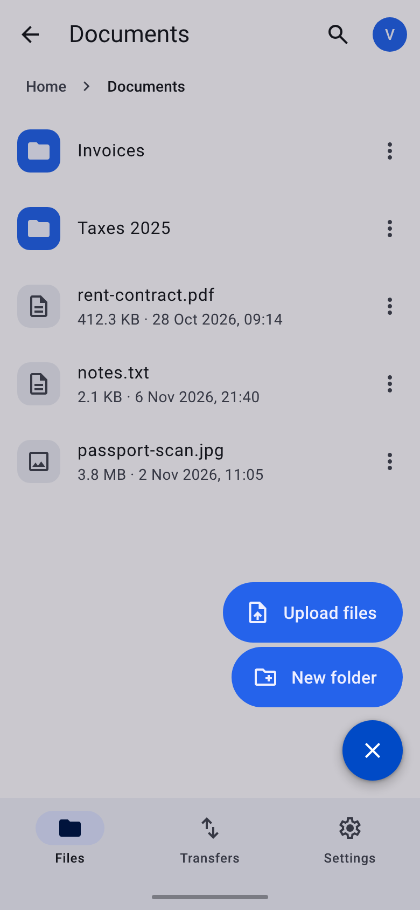

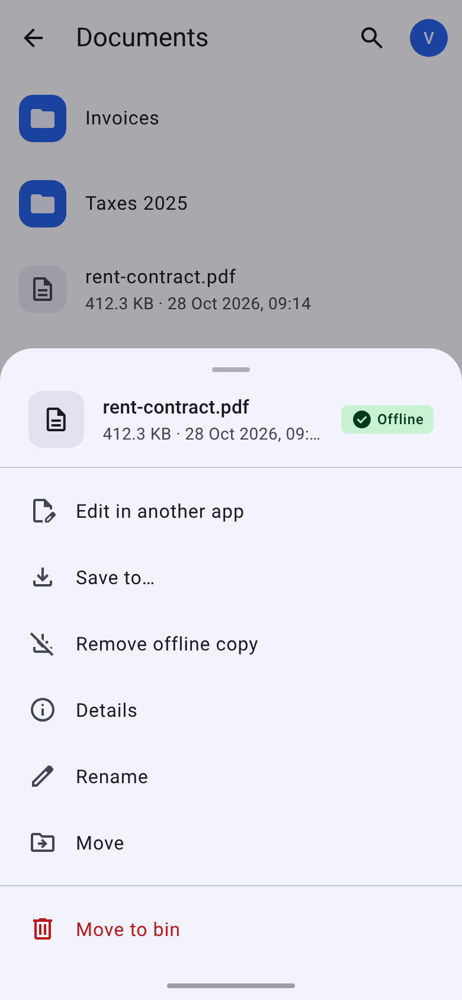 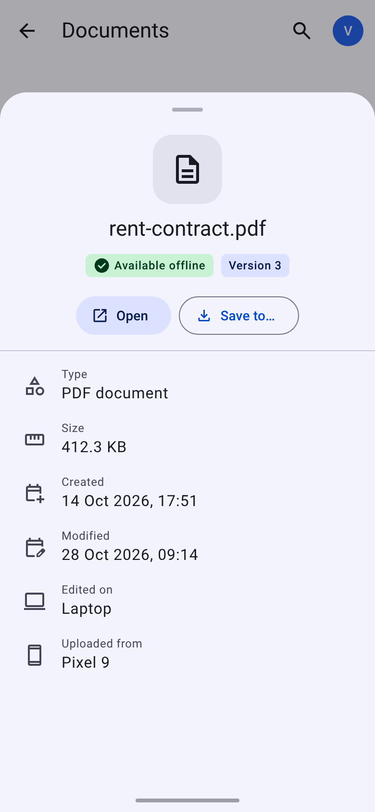

- **Navigation bar** with Files, Transfers and Settings replaces the overflow menu (Material: 3–5
  top-level destinations belong in a navigation bar). The Transfers badge counts failed uploads.
  Profile opens from the avatar in the top app bar.
- **Top app bar**: back to the parent, folder name as the title, search, avatar. The path is a
  breadcrumb row under the bar instead of the drop-down.
- **List items**: Material two-line items, a 40dp icon tile (folders in `primaryContainer`), 72dp rows.
  Offline badges keep the desktop meaning (check = available offline, sync = updating, error =
  failed). Downloads show a linear progress bar and a cancel button in the row.
- **Uploads summary**: a filled card at the top with a linear progress bar; tapping it opens Transfers.
- **Selection**: a contextual top app bar (close, “2 selected”, select all) and a bottom toolbar with
  Move, Offline, Delete and More. Selected rows use `secondaryContainer`.
- **New**: an extended FAB that opens a FAB menu with Upload files and New folder.
- **Row actions**: a modal bottom sheet with the file as its header, replacing the drop-down menu.
  “Move to bin” is last, in `error`, below a divider.
- **Details**: a full-height bottom sheet with the file's state chips, Open / Save to… buttons, and
  the existing fields (type, size, created, modified, edited on, uploaded from).

### Dialogs

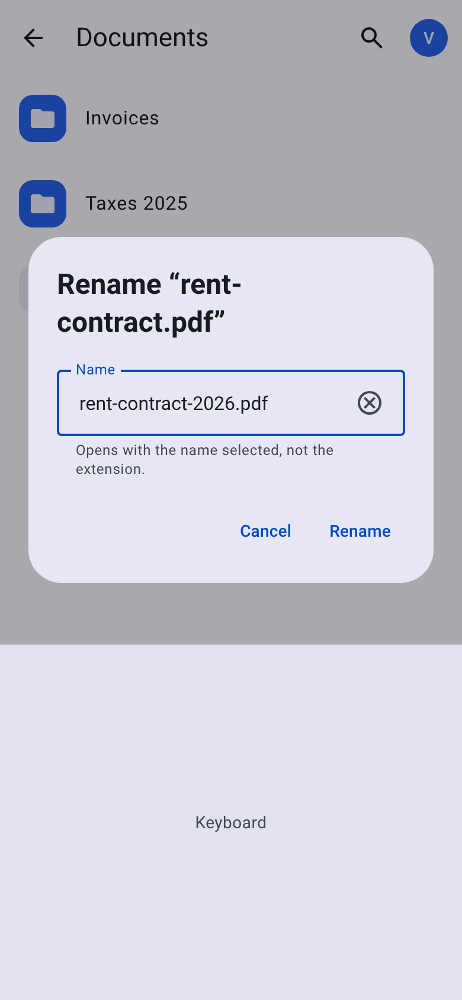 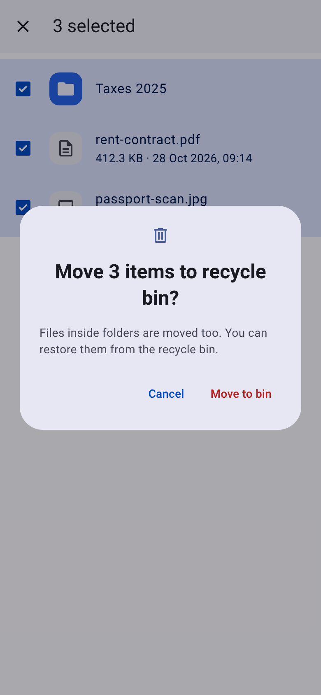 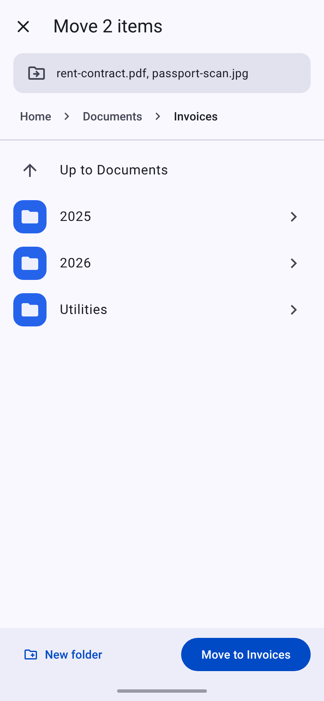

- Rename and New folder stay basic dialogs with an outlined field; rename opens with the name
  selected but not the extension.
- Move to bin is an alert dialog with an icon and an `error` confirm button.
- **Move becomes a full-screen dialog** (Material recommends full-screen dialogs on compact screens
  for tasks like picking a destination): what is being moved, breadcrumbs, the folder list, and a
  bottom bar with the confirm button.

### Search, transfers, settings

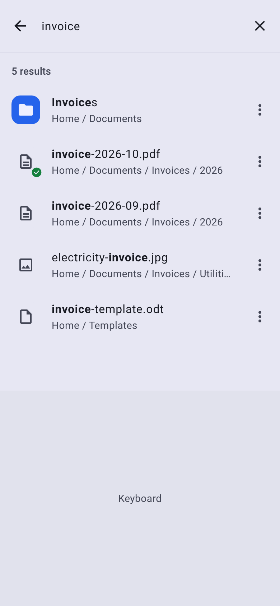 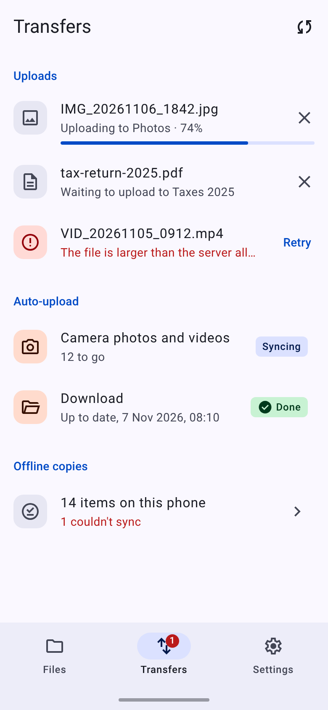 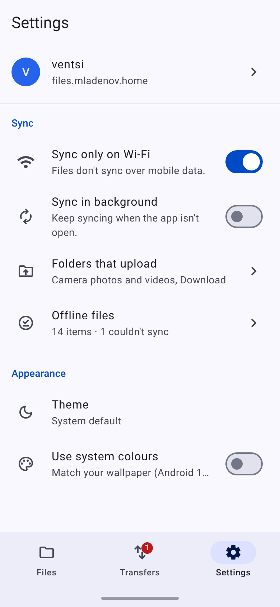

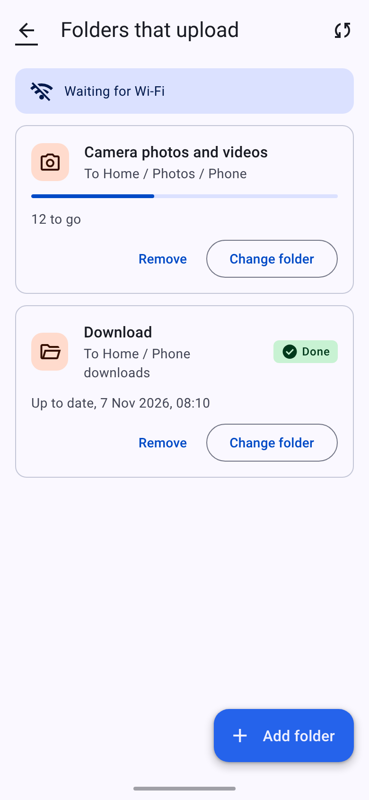 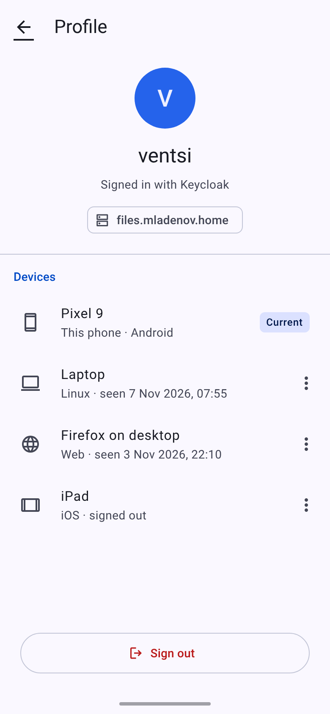

- **Search**: the full-screen Material search view; matches are bold and the location is the
  supporting line.
- **Transfers**: a top-level tab with Uploads, Auto-upload and Offline copies sections, per-item
  progress and status chips.
- **Settings**: the sync switches are directly in the tab (one step less than today). The upload
  folders have their own screen with one card per folder and an “Add folder” FAB.
- **Profile**: account, server, and the user's devices from `GET /devices`, with Sign out at the
  bottom.

### Not in the app yet

These are drawn but not built:

- “Signed in with Keycloak” on Profile: the app doesn't keep how the user signed in.
- The menu on each row of Profile's devices list (the list itself only shows them).

## Updating

1. Edit the canvas, then copy its `project/*.dc.html`, `project/m3.css` and `project/canvas.json`
   into `source/`.
2. Regenerate the pages and images:

   ```sh
   cd docs/designs/mobile/android/tools
   npm install
   npx playwright install chromium
   npm run build
   ```

The `.dc.html` files need the canvas runtime, so open `html/` (not `source/`) in a browser.
